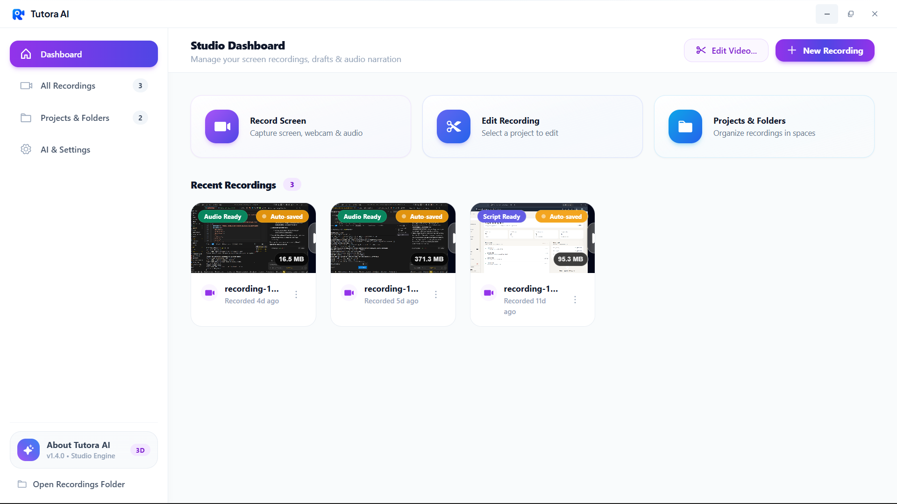
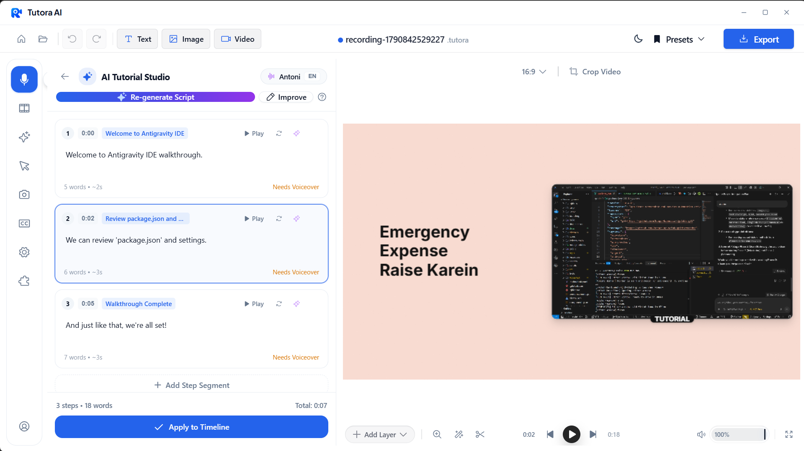
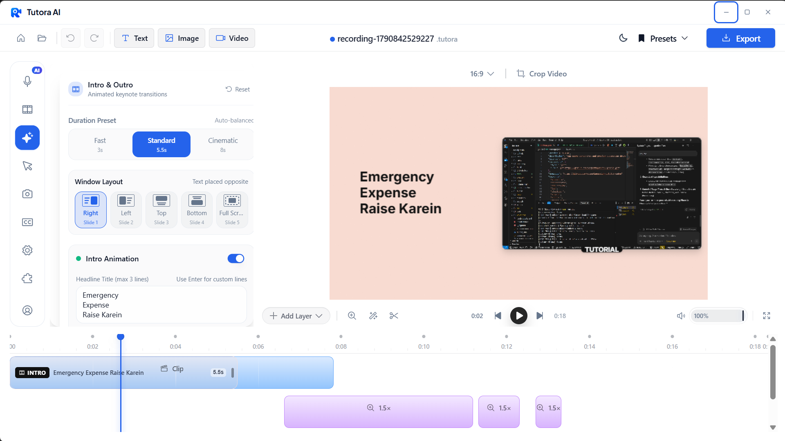
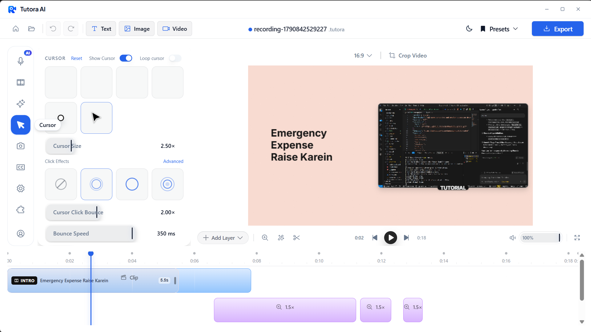
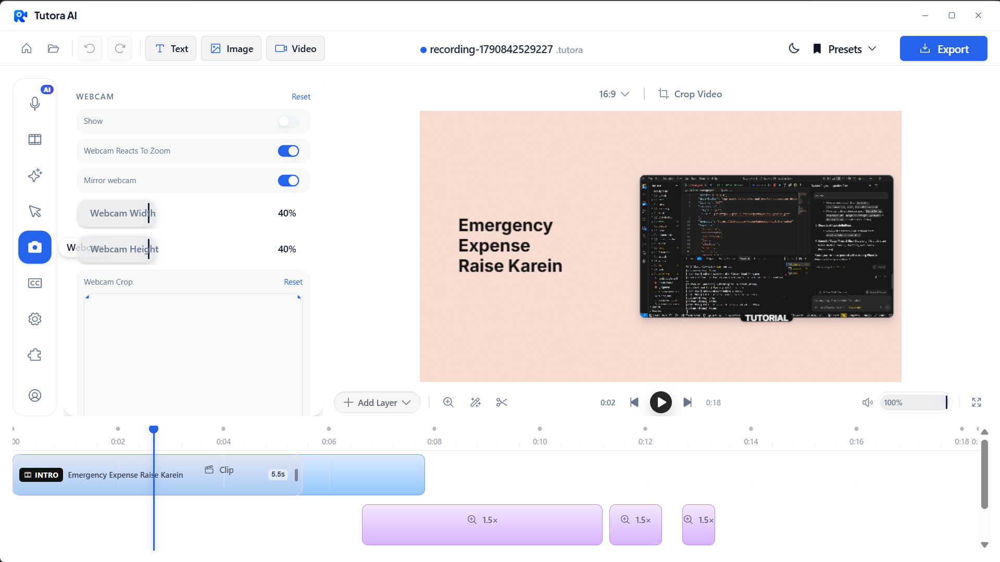
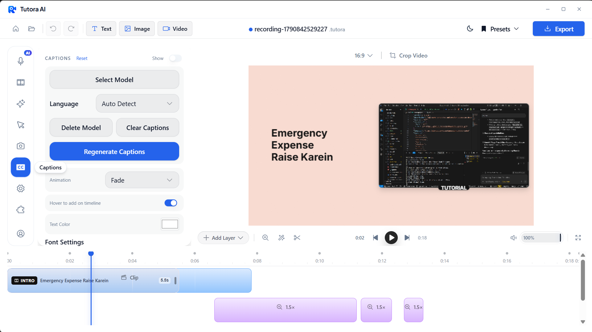
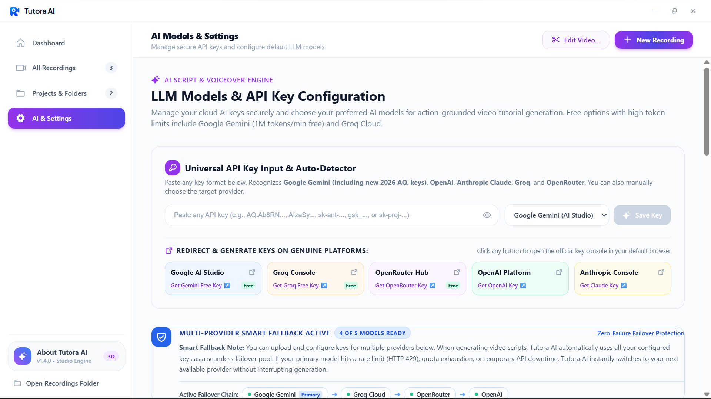

# Tutora AI 🎙️✨

  

<h2 align="center">Create Polished Screen Demos, AI-Narrated Walkthroughs & Video Tutorials in Minutes</h2>

  
  
  
  

---

## 💡 What is Tutora AI?

**Tutora AI** is an all-in-one desktop studio designed for developers, creators, educators, and product teams. It combines high-performance platform capture, motion-driven timeline editing, automated cursor smoothing, dynamic auto-zooms, and an **embedded 100% offline Neural Voice Studio**.

Instead of spending hours manually recording voiceovers, editing clips in complex timeline software, or hiring motion designers for smooth zoom cuts, **Tutora AI handles the entire recording, AI script generation, voice synthesis, and video production workflow in one unified application**.

---

## 📥 Download & Releases

Download the latest official installer for your operating system:

| Platform | Recommended Installer | Format | Architecture |
| :--- | :--- | :--- | :--- |
| **Windows** | [Download Tutora-AI-Setup-1.4.0.exe](https://github.com/MilannSharma/Tutora-AI/releases/latest) | `.exe` (Installer / Portable) | x64 / ARM64 |
| **macOS** | [Download Tutora-AI-1.4.0.dmg](https://github.com/MilannSharma/Tutora-AI/releases/latest) | `.dmg` | Apple Silicon (M1/M2/M3/M4) & Intel |
| **Linux** | [Download Tutora-AI-1.4.0.AppImage](https://github.com/MilannSharma/Tutora-AI/releases/latest) | `.AppImage` / `.deb` | x64 |

> 💡 **Tip**: All binary releases are cryptographically signed with SHA-256 checksums available in the [GitHub Releases](https://github.com/MilannSharma/Tutora-AI/releases) tab.

---

## 🌟 Visual Feature Tour

### 1. Studio Dashboard
Manage all your screen recordings, drafts, and narration pipelines from a clean, intuitive studio dashboard. Group recordings into dedicated folders and track project statuses (*Draft Script*, *Script Ready*, *Audio Ready*, *Completed*).

  

---

### 2. 🎙️ AI Tutorial Studio & Offline Voice Engine
Generate step-by-step narration scripts directly from your capture timeline. Powered by an embedded **Kokoro v1.0 & Resona neural voice engine**, Tutora AI synthesizes lifelike voiceovers **100% offline** without any recurring cloud API costs, zero latency, and complete privacy.

* **57 High-Fidelity Voices**: American English, British English, Hindi, and natural Hinglish voices.
* **Per-Step Narration Sync**: Generate, edit, preview, and apply voiceover segments directly to the timeline.
* **Hardware Acceleration**: Automatic NVIDIA CUDA GPU acceleration with PyTorch CPU fallback.

  

---

### 3. 🎬 Multi-Track Timeline & Animated Keynotes
Bring your walkthroughs to life with animated keynote intro/outro transitions. Customize duration presets (*Fast 3s*, *Standard 5.5s*, *Cinematic 8s*) and window layouts (*Right*, *Left*, *Top*, *Bottom*, *Full Screen*).

  

---

### 4. 🎯 Cursor Smoothing & Spring Physics
Raw mouse movements look jittery. Tutora AI applies real-time spring physics to smooth your cursor paths, render customizable click shockwaves, and bounce click animations.

* **Custom Cursor Sizing**: Adjust scale up to 4.0× for crystal-clear visibility on 4K displays.
* **Click Animations**: Choose between ripple, shockwave, bounce, and pulse visual cues.
* **Theme Support**: Windows 11, macOS, and custom custom styled cursor packs.

  

---

### 5. 📹 Dynamic Webcam Bubble Overlays
Keep your audience connected by overlaying your facecam in a floating bubble.

* **Zoom-Reactive Scaling**: Webcam automatically adapts size during dynamic zoom cuts so your face never covers essential UI elements.
* **Mirroring & Aspect Ratio**: 1:1 circular bubble, 16:9 pill, and custom corner radii with drop shadows.

  

---

### 6. 💬 Automatic Captions & Subtitles
Generate accurate open captions and animated subtitles with customizable animations (Fade, Slide, Bounce, Pop) and custom typography tokens.

  

---

### 7. ⚡ Universal AI Model Hub & Zero-Failure Failover
Bring your own API key (BYOK) with multi-provider failover protection. Configure Google Gemini (including 1M tokens/min free tier), Groq Cloud, OpenRouter, OpenAI, and Anthropic Claude.

* If one provider encounters a rate limit (HTTP 429) or quota limit, Tutora AI **automatically switches to your next configured provider in real-time** without interrupting script generation.

  

---

## 💻 System Requirements

| Specification | Minimum | Recommended |
| :--- | :--- | :--- |
| **Operating System** | Windows 10 (Build 19041+), macOS 14+, Ubuntu 22.04+ | Windows 11 / macOS 15+ (Sequoia) |
| **Processor** | Intel Core i5 / AMD Ryzen 5 / Apple M1 | Intel Core i7 / AMD Ryzen 7 / Apple M2 or newer |
| **RAM** | 8 GB | 16 GB or higher |
| **GPU** | Integrated Graphics (DirectX 12 / Metal) | Dedicated NVIDIA GPU (CUDA 12+) for instant AI synthesis |
| **Disk Space** | 2 GB available storage | SSD storage recommended |

---

## 📁 Project Format & Compatibility

Tutora AI uses the native `.tutora` project format. Existing files from previous versions are 100% backward compatible:
* **Supported formats**: `.tutora`, `.recordly`, `.guidely`
* **Portability**: All timeline edits, zoom points, voice clips, and keynote settings are serialized in standard JSON packages.

---

## 🤝 Community & Support

* **Report Bugs**: [GitHub Issue Tracker](https://github.com/MilannSharma/Tutora-AI/issues)
* **Request Features**: Open a feature proposal in [Discussions](https://github.com/MilannSharma/Tutora-AI/discussions)
* **Star the Repo**: If you love Tutora AI, please give us a ⭐️ to support open-source development!

---

## 📜 License

Tutora AI is licensed under the **GNU Affero General Public License v3.0 (AGPL-3.0)**.
See the [LICENSE](LICENSE) file for more details.
