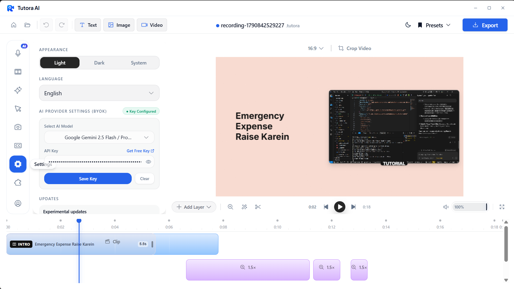

<div align="center">



<br/>

<a href="#-download--releases"></a>


<br/><br/>

<b>Record → Script → Voice → Export. One app. Zero cloud bills.</b>

<br/><br/>



</div>


<a id="-what-is-tutora-ai"></a>


**Tutora AI** is an all-in-one desktop studio for developers, creators, educators and product teams. It combines high-performance screen capture, motion-driven timeline editing, automated cursor smoothing, dynamic auto-zooms and an **embedded, 100% offline Neural Voice Studio**.

Instead of recording voiceovers by hand, cutting clips in heavy timeline software or hiring a motion designer for smooth zooms, **Tutora AI handles recording, AI script generation, voice synthesis and video production inside one application**.

| 😩 The old way | ✨ With Tutora AI |
| :--- | :--- |
| Record voiceover, redo it after every typo | AI writes the script, offline voices narrate it |
| Keyframe every zoom by hand | Dynamic auto-zoom follows your actions |
| Jittery cursor, invisible clicks | Spring-smoothed cursor with click shockwaves |
| Pay per minute for cloud TTS | Embedded Kokoro + Resona engine, no recurring cost |
| Locked into one AI vendor | Bring your own key, automatic multi-provider failover |


<div align="center">

</div>


<a id="-download--releases"></a>


Download the latest official installer for your operating system:

| Platform | Recommended Installer | Format | Architecture |
| :--- | :--- | :--- | :--- |
| 🪟 **Windows** | [Download Tutora-AI-Setup-1.4.0.exe](https://github.com/MilannSharma/Tutora-AI/releases/latest) | `.exe` (Installer / Portable) | x64 / ARM64 |
| 🍎 **macOS** | [Download Tutora-AI-1.4.0.dmg](https://github.com/MilannSharma/Tutora-AI/releases/latest) | `.dmg` | Apple Silicon (M1/M2/M3/M4) & Intel |
| 🐧 **Linux** | [Download Tutora-AI-1.4.0.AppImage](https://github.com/MilannSharma/Tutora-AI/releases/latest) | `.AppImage` / `.deb` | x64 |

> 💡 **Tip:** All binary releases are cryptographically signed. SHA-256 checksums are listed in the [GitHub Releases](https://github.com/MilannSharma/Tutora-AI/releases) tab.


<a id="-visual-feature-tour"></a>


<div align="center">

<br/>
<sub>🎞️ Auto-plays every 5 seconds. Each slide shows its own title and caption.</sub>
</div>

<br/>

### 1. 📊 Studio Dashboard
Manage recordings, drafts, and narration pipelines from one organized hub. Group clips into dedicated project spaces and folders, and monitor real-time pipeline badges (*Draft Script* → *Script Ready* → *Audio Ready* → *Completed*).

<p align="center">
  
</p>

---

### 2. 🎙️ AI Tutorial Studio & Offline Voice Engine
Generate step-by-step narration scripts directly from your capture timeline. An embedded **Kokoro v1.0 & Resona neural voice engine** synthesizes lifelike voiceovers **100% offline**: no recurring cloud API cost, no network latency, and complete privacy.

* 🗣️ **57 high-fidelity voices:** American English, British English, Hindi, and natural Hinglish
* 🔁 **Per-step narration sync:** generate, edit, preview, and apply voiceover segments straight to the timeline
* 🚀 **Hardware acceleration:** automatic NVIDIA CUDA GPU acceleration with PyTorch CPU fallback

<p align="center">
  
</p>

<div align="center">
  
</div>

---

### 3. 🎬 Multi-Track Timeline & Keynote Transitions
Elevate raw recordings into polished video walkthroughs with animated keynote intro/outro transitions. Customize duration presets (*Fast 3s*, *Standard 5.5s*, *Cinematic 8s*) and window layouts (*Right*, *Left*, *Top*, *Bottom*, *Full Screen*).

<p align="center">
  
</p>

---

### 4. 🎯 Cursor Smoothing & Spring Physics
Raw mouse movements look jittery on screen. Tutora AI applies real-time spring physics to your cursor paths, eliminates sudden shakes, and renders click shockwaves and bounce animations.

* 🔎 **Custom cursor sizing:** scale up to 4.0× for crystal-clear visibility on 4K displays
* 💥 **Click cues:** ripple, shockwave, bounce, and pulse cues
* 🎨 **Theme support:** Windows 11, macOS, and custom minimal cursor styles

<p align="center">
  
</p>

<div align="center">
  
</div>

---

### 5. 📹 Dynamic Webcam Bubble Overlays
Keep your audience engaged with an interactive facecam overlay that dynamically reacts to what's happening on your screen.

* 🎯 **Zoom-reactive scaling:** automatically scales down during zoom cuts so presenter reactions stay visible without blocking essential UI elements
* 🪞 **Mirroring & Aspect Ratio:** 1:1 circular bubble, 16:9 pill, custom corner radius, and drop shadows

<p align="center">
  
</p>

---

### 6. 💬 Automatic Captions & Subtitles
Generate accurate open captions and animated subtitles with customizable animations (*Fade*, *Slide*, *Bounce*, *Pop*) and custom typography tokens.

<p align="center">
  
</p>

---

### 7. ⚡ Universal AI Model Hub & Zero-Failure Failover
Bring your own API key (BYOK) and configure **Google Gemini** (including 1M tokens/min free tier), **Groq Cloud**, **OpenRouter**, **OpenAI**, and **Anthropic Claude**. If a provider hits a rate limit (HTTP 429) or quota exhaustion, Tutora AI **switches to your next configured provider in real time** without interrupting script generation.

<p align="center">
  
</p>

<div align="center">
  
</div>

---

### 8. ⚙️ In-Editor Settings & Appearance
Easily toggle between Light, Dark, and System themes, manage language preferences, and fine-tune export quality settings directly from the editor panel.

<p align="center">
  
</p>


1. **📥 Install** the build for your OS from the [Releases](https://github.com/MilannSharma/Tutora-AI/releases/latest) page.
2. **🔑 Add an AI key** (optional but recommended) in *Settings → AI Models*. Add more than one provider to enable automatic failover.
3. **🎥 Record** your screen, with or without webcam, and let cursor smoothing and auto-zoom do the polish.
4. **🎙️ Open AI Tutorial Studio**, generate the script, pick one of the 57 offline voices and apply the narration to the timeline.
5. **🚀 Add a keynote intro/outro, captions** and export your finished tutorial.


| Specification | Minimum | Recommended |
| :--- | :--- | :--- |
| **Operating System** | Windows 10 (Build 19041+), macOS 14+, Ubuntu 22.04+ | Windows 11 / macOS 15+ (Sequoia) |
| **Processor** | Intel Core i5 / AMD Ryzen 5 / Apple M1 | Intel Core i7 / AMD Ryzen 7 / Apple M2 or newer |
| **RAM** | 8 GB | 16 GB or higher |
| **GPU** | Integrated Graphics (DirectX 12 / Metal) | Dedicated NVIDIA GPU (CUDA 12+) for instant AI synthesis |
| **Disk Space** | 2 GB available storage | SSD storage recommended |


Tutora AI uses the native `.tutora` project format. Files from previous versions are 100% backward compatible.

* 📦 **Supported formats:** `.tutora`, `.recordly`, `.guidely`
* 🔁 **Portability:** timeline edits, zoom points, voice clips and keynote settings are serialized in standard JSON packages


* 🐛 **Report bugs:** [GitHub Issue Tracker](https://github.com/MilannSharma/Tutora-AI/issues)
* 💡 **Request features:** open a proposal in [Discussions](https://github.com/MilannSharma/Tutora-AI/discussions)
* ⭐ **Star the repo:** if Tutora AI saves you time, a star supports open-source development!

<details>
<summary><b>🛠️ Maintainers: how the animated README works</b></summary>
<br/>

GitHub strips JavaScript and CSS from READMEs, so every animation here is a self-contained **SVG with SMIL animation** loaded through ``. All files in `assets/animations/` are generated by one script:

```bash
pip install pillow                       # optional, shrinks screenshots inside the slideshow
python scripts/build-readme-assets.py    # run from the repo root
```

To change a slideshow title, caption or screenshot, edit the `SLIDES` list at the top of `scripts/build-readme-assets.py` and re-run it. Commit the regenerated SVGs.

</details>


Tutora AI is licensed under the **GNU Affero General Public License v3.0 (AGPL-3.0)**. See the [LICENSE](LICENSE) file for details.
